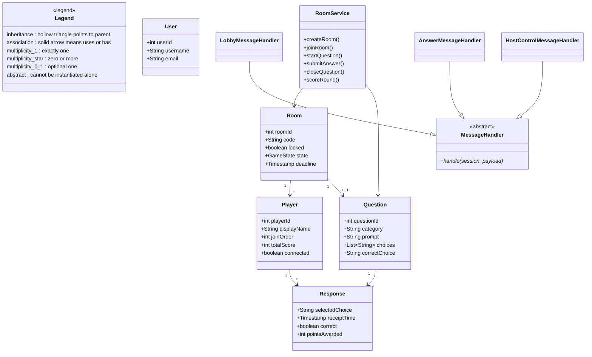

# Detailed Design Document
## Real-Time Multiplayer Quiz Game
**CSCI 201 — Fall 2026 · Team 12**  
**Due:** November 1, 2026  
**Based on:** *201 Final Group Project Technical Specifications*

---

## 1. Document Purpose

This document designs every task outlined in the Technical Specifications so that an implementer unfamiliar with the application can build it. It covers difficult algorithms, the intended GUI, the database schema, hardware/software requirements, class structure and inheritance, and the network/concurrency design that supports live multiplayer play.

---

## 2. System Overview

The application is a browser-based real-time multiplayer quiz. Players register or log in against a central Java server, create or join rooms by code, answer the same timed questions, see live answer counts, and receive scores and rankings when each round ends.

| Layer | Technology |
|-------|------------|
| Client | HTML, CSS, vanilla JavaScript (nine pages) |
| Live play | Jakarta WebSocket on Apache Tomcat 10 |
| Non-live API | Jakarta REST servlets (JSON request/response) |
| Server runtime | Java 17 on Apache Tomcat 10 |
| Persistence | Relational database (MySQL or MariaDB) |

The server is the only source of truth for room state, deadlines, answers, and scores. Clients render UI and calculate remaining time from the server-issued deadline; they never decide correctness or points locally.

---

## 3. Traceability to Technical Specifications

| Tech Spec task | Design coverage |
|----------------|-----------------|
| Room and Lobby Management | §§ 5.1, 6 (Lobby), 7–8 |
| System Architecture | §§ 2, 8–9 |
| Questions and Timing | §§ 5.2, 6 (Question), 7 |
| Answers and Statistics | §§ 5.3, 6 (Question/Results), 7 |
| Scoring and Session Completion | §§ 5.4, 6 (Results/Leaderboard), 7 |
| Data Storage | § 7 |
| System Requirements and Benchmarks | § 4 |
| Front End (nine pages) | § 6 |
| Back End (servlets + WebSocket) | §§ 8–9 |
| Accounts (login/register) | §§ 5.5, 6 (Auth pages), 7 (`users`) |

---

## 4. Hardware and Software Requirements

### 4.1 Client (player machine)

- Desktop or laptop with a modern browser that supports JavaScript and WebSockets (Chrome, Firefox, Safari, or Edge, current major version).
- Stable internet connection.
- Display resolution of at least 1280×720 recommended for lobby and question layouts.

### 4.2 Server

| Resource | Minimum (spec) |
|----------|----------------|
| CPU | 2 cores |
| RAM | 4 GB |
| Disk | 1 GB free for application, database, and logs |
| OS | Linux, macOS, or Windows capable of running Tomcat 10 |
| Runtime | Java 17 JDK/JRE |
| Application server | Apache Tomcat 10 (Jakarta EE servlet + WebSocket) |
| Database | MySQL 8+ or MariaDB 10.6+ |
| Network | Port for HTTP/HTTPS (and WebSocket upgrade on the same host) |

### 4.3 Development software

- Git for version control.
- IDE such as IntelliJ IDEA or Eclipse.
- Build tool: Maven or Gradle (team choice at implementation).
- Optional: Postman or curl for servlet testing; browser DevTools for WebSocket inspection.

### 4.4 Performance targets (from Technical Specifications)

With 20 simultaneous players in one room on a stable test network:

- Joins and ordinary lobby actions complete within **2 seconds**.
- Question delivery, answer counters, and round results update for all connected clients within **1 second** of the server event.

---

## 5. Difficult Algorithms and Critical Logic

### 5.1 Room code generation

When a host creates a room, the server generates a short alphanumeric code (e.g., 6 characters from `A–Z` / `0–9`), checks uniqueness among **active** rooms, and retries on collision. Codes for ended rooms may be reused after the room is archived or deleted.

### 5.2 Display-name uniqueness (case-insensitive)

On join, trim whitespace and compare names with case folded (e.g., Unicode case-insensitive equality). Reject duplicates in the same room with a clear error so the client can prompt for another name.

### 5.3 Shared question deadline (authoritative timing)

1. Host starts a question (or advances after the previous round closes).
2. Server loads the next question for the room’s category, records `start_time` and `deadline = start_time + host_selected_seconds` (default 20).
3. Server broadcasts `question_id`, prompt, choices, `deadline` (absolute server time or epoch millis).
4. Clients show a countdown derived from `deadline − now`; late HTTP/WebSocket submissions with `receipt_time > deadline` are rejected.
5. At deadline (server timer thread or scheduled task), answers freeze; scoring and reveal run once.

The host does **not** auto-advance; the next question starts only on host action (or the game ends when the question set is exhausted).

### 5.4 Single accepted answer per player per question

Key constraint: at most one response row per `(room_id, player_id, question_id)`.

- First valid choice inserts the row.
- Later replacements before the deadline **update** the same row (`selected_choice`, `receipt_time`); they do **not** increment the “players answered” count.
- Concurrent duplicate messages are handled with a unique DB constraint and/or synchronized room lock so points cannot be awarded twice.

### 5.5 Live answer count

Maintain a set (or distinct count) of `player_id`s with a non-null accepted answer for the active question. Broadcast the count on insert; do not change it on replace. Unanswered players are not counted.

### 5.6 Scoring with response-time adjustment

Per Technical Specifications:

- Base: **100 points** for a correct final answer; **0** for incorrect or missing.
- Time adjustment: subtract a function of cumulative (or per-question) response time measured from question start to accepted answer. Design choice for implementation (document in code comments):  
  `points = max(0, 100 − floor(response_ms / K))` for correct answers, with constant `K` chosen so a full-duration answer still yields a meaningful positive score (e.g., `K = 200` for a 20s round → minimum 0). Incorrect/missing remain 0.
- Points applied **once** per question per player when the round closes.
- Ties for ranking: higher score first; remaining ties broken by **lobby join order** (ascending).

### 5.7 Disconnect / reconnect / host pause

- Non-host disconnect: stop delivering updates to that socket; keep prior answers and scores; allow reconnect by re-associating session/`player_id` to the room and resuming state sync.
- Host disconnect: after the current question ends, **pause** the session until the host returns; after a configured timeout, end the session.
- Reconnect restores last known room state (lobby lock, scores, current phase) from the server.

### 5.8 Concurrent room mutations

Each active room has a server-side lock (monitor or `ReentrantLock`) around state transitions: join, lock lobby, start game, accept answer, close question, score. WebSocket messages for a room are processed under that lock or via a single-threaded room actor so answer evaluation and scoring stay race-free.

---

## 6. GUI Design

Nine pages (HTML/CSS/JS). Slight visual refinement after this document is allowed.

### 6.1 Page map

| # | Page | Audience | Purpose |
|---|------|----------|---------|
| 1 | Landing / Home | Guest or logged-in | Branding, links to Login, Register, and (if authenticated) Create/Join Room |
| 2 | Register | Guest | Create account (username, email, password) |
| 3 | Login | Guest | Authenticate against central server; obtain session |
| 4 | Create Room | Authenticated | Category (optional until lobby), create room → receive code; enter as host |
| 5 | Join Room | Authenticated | Enter room code + display name |
| 6 | Lobby | In-room players | Player list, host controls (category, lock, remove, start), room code |
| 7 | Question | In-game | Prompt, choices, countdown, live “answered” count |
| 8 | Round Results | In-game | Correct answer, correct-count, updated scores |
| 9 | Final Leaderboard / History | End of session / authenticated | Rankings; optional past-session stats via REST |

### 6.2 Guest vs authenticated experience

- **Guests** may view Landing, Register, and Login only. They cannot create or join rooms until authenticated (course requirement: different experience for guests vs logged-in users).
- **Authenticated** users access Create Room, Join Room, lobby, gameplay, and history/statistics.

### 6.3 Screen wireframes (textual)

**Landing**  
Header with app name → primary buttons: Log In, Register → short description of multiplayer quizzes → footer.

**Register / Login**  
Centered form card: fields + submit + link to the other auth page. Inline error text for invalid credentials or duplicate username.

**Create Room / Join Room**  
Create: “Create Room” button (and optional category default). Success shows room code and navigates to Lobby.  
Join: code field, display-name field, Join button; error for invalid/locked/started rooms or duplicate names.

**Lobby**  
Left/main: scrollable player list (name, host badge, connection status).  
Right/host panel (host only): category dropdown, Lock/Unlock, Remove player, Start Game.  
All players see room code and lock status.

**Question**  
Large prompt; 2–4 choice buttons; countdown timer; “X / N answered” badge. Choices disable after personal submit (re-click allowed to change before deadline). Non-interactive reveal of correctness until Results.

**Round Results**  
Highlighted correct choice; count of correct players; score table snapshot; host-only “Next Question” / “End Game”.

**Final Leaderboard**  
Ordered ranking (score, then join order); option to return Home or view history.

### 6.4 Client responsibilities (non-authoritative)

- Maintain WebSocket connection while in a room; reconnect with backoff.
- Render broadcasts (`lobby_update`, `question_start`, `answer_count`, `round_result`, `game_over`, `paused`).
- Compute countdown UI from server `deadline`.
- Call REST for register, login, create/join room bootstrap, and history.

---

## 7. Database Schema

### 7.1 Entity-relationship summary

`users` 1—* `rooms` (as host)  
`rooms` 1—* `room_players` *—1 `users` (or anonymous display binding via `player_id`)  
`questions` many per `category`  
`rooms` 1—* `responses`  
`room_players` and `questions` participate in `responses`

### 7.2 Tables

#### `users`
| Column | Type | Notes |
|--------|------|--------|
| `user_id` | INT PK AI | |
| `username` | VARCHAR(64) UNIQUE NOT NULL | |
| `email` | VARCHAR(255) UNIQUE NOT NULL | |
| `password_hash` | VARCHAR(255) NOT NULL | salted hash (e.g., BCrypt) |
| `created_at` | TIMESTAMP | |

#### `rooms`
| Column | Type | Notes |
|--------|------|--------|
| `room_id` | INT PK AI | |
| `code` | VARCHAR(16) NOT NULL | unique among active rooms |
| `host_user_id` | INT FK → users | |
| `category` | VARCHAR(64) | |
| `locked` | BOOLEAN DEFAULT FALSE | |
| `game_state` | ENUM/VARCHAR | `LOBBY`, `QUESTION`, `RESULTS`, `PAUSED`, `ENDED` |
| `current_question_id` | INT NULL FK → questions | |
| `deadline` | TIMESTAMP NULL | active question deadline |
| `created_at` | TIMESTAMP | |

#### `room_players`
| Column | Type | Notes |
|--------|------|--------|
| `player_id` | INT PK AI | |
| `room_id` | INT FK → rooms | |
| `user_id` | INT FK → users | |
| `display_name` | VARCHAR(64) NOT NULL | |
| `join_order` | INT NOT NULL | tie-break |
| `connected` | BOOLEAN | |
| `total_score` | INT DEFAULT 0 | |
| `cumulative_correct_time_ms` | BIGINT DEFAULT 0 | for ranking/adjustment |

Unique: `(room_id, lower(display_name))` enforced in application and/or generated column.

#### `questions`
| Column | Type | Notes |
|--------|------|--------|
| `question_id` | INT PK AI | |
| `category` | VARCHAR(64) NOT NULL | |
| `prompt` | TEXT NOT NULL | |
| `choice_a` … `choice_d` | VARCHAR(512) | or JSON `choices` array |
| `correct_choice` | CHAR(1) or VARCHAR | e.g., `A`/`B`/`C`/`D` |

#### `responses`
| Column | Type | Notes |
|--------|------|--------|
| `response_id` | INT PK AI | |
| `room_id` | INT FK | |
| `player_id` | INT FK | |
| `question_id` | INT FK | |
| `selected_choice` | VARCHAR | |
| `receipt_time` | TIMESTAMP | server receipt |
| `correct` | BOOLEAN | set at freeze |
| `points_awarded` | INT | set at freeze |

**Unique constraint:** `(room_id, player_id, question_id)` — enforces one response record per player per question.

### 7.3 Schema diagram (textual)

```
users ──< rooms (host_user_id)
users ──< room_players >── rooms
questions (by category)
rooms ──< responses >── room_players
              responses >── questions
```

---

## 8. Class Design and Inheritance

### 8.1 Package sketch

```
edu.usc.csci201.quiz
  ├── model          // domain objects
  ├── dao            // persistence
  ├── service        // room/game logic
  ├── servlet        // REST
  ├── websocket      // live endpoint
  └── util           // timing, passwords, JSON
```

### 8.2 Core model classes

| Class | Responsibility |
|-------|----------------|
| `User` | Identity credentials (no password in memory after auth) |
| `Room` | Code, host, lock, `GameState`, current question, deadline |
| `Player` | Display name, join order, score, connection flag |
| `Question` | Prompt, choices, correct key |
| `Response` | Choice, times, correctness, points |
| `GameState` | Enum: LOBBY, QUESTION, RESULTS, PAUSED, ENDED |

### 8.3 Inheritance / interfaces

```
<<interface>> GameEventListener
        ▲
        │ implements
RoomSession ────────────────── uses ──► RoomService
        │
        ▼
<<abstract>> MessageHandler
        ▲
        ├── LobbyMessageHandler
        ├── AnswerMessageHandler
        └── HostControlMessageHandler

<<interface>> RoomDao / UserDao / QuestionDao / ResponseDao
        ▲
        └── Jdbc*Dao implementations
```

- **`MessageHandler` (abstract):** shared parse/validate of WebSocket JSON; subclasses handle lobby vs answer vs host controls.
- **`Dao` interfaces** with JDBC implementations keep persistence swappable and testable.
- **`RoomService`:** single place for algorithms in §5; called by servlets and WebSocket endpoint.
- **`QuizWebSocketEndpoint`:** Jakarta `@ServerEndpoint`; maps connections to `RoomSession` by room code.

No JSP and no Java Swing/JavaFX UI (course constraint). Browser is the only GUI.

### 8.4 Class diagram (Mermaid — for export to image if desired)



---

## 9. Network and Concurrency Design

### 9.1 REST servlets (HTTP + JSON)

Examples (paths illustrative):

| Method | Path | Purpose |
|--------|------|---------|
| POST | `/api/register` | Create user |
| POST | `/api/login` | Authenticate; create session |
| POST | `/api/logout` | End session |
| POST | `/api/rooms` | Create room (auth) |
| POST | `/api/rooms/join` | Join by code + display name |
| GET | `/api/rooms/{code}` | Lobby snapshot (optional) |
| GET | `/api/history` | Past scores for user |
| GET | `/api/stats` | Aggregate statistics |

Session cookie or token required for room and history endpoints.

### 9.2 WebSocket

- Single Jakarta WebSocket endpoint (e.g., `/ws/game`).
- After HTTP join/create, client opens WebSocket and sends `subscribe` with room code + player/session id.
- Server pushes: lobby updates, question start, answer counts, round results, pause/end.
- Client sends: answer submissions, host actions (lock, remove, start, next, end) — validated server-side (host-only where required).

### 9.3 Multithreading

- Tomcat thread pool for HTTP and WebSocket I/O.
- Per-room lock for state mutations (§5.8).
- Scheduled executor for question deadlines (one task per active question; cancel on early host end if allowed).
- DAO calls use short-lived DB connections from a pool; no long locks held across network waits beyond the room critical section needed for consistency.

This satisfies the course requirement for multithreading and networking beyond chat: concurrent rooms, concurrent answer submissions, and deadline timers.

---

## 10. Key Sequence Summaries

### 10.1 Create and start

1. User registers/logs in (REST).  
2. Host creates room → code returned → opens WebSocket → Lobby.  
3. Others join via code + name; lobby list broadcasts.  
4. Host sets category, optionally locks, starts game.  
5. Server loads questions for category; host advances question-by-question.

### 10.2 One question round

1. Server sets deadline; broadcasts question (no correct answer).  
2. Players submit/replace answers; live count updates.  
3. Deadline fires → freeze → grade → award points → broadcast results.  
4. Host chooses Next or End; if no questions remain, final leaderboard.

---

## 11. Non-Goals / Deferred

- Mobile-native clients (browser only for this design).  
- Paid cloud hosting specifics (local/Tomcat deployment; cost \$0 per tech specs unless revised).  
- Automatic question advance without host action.  
- Chat as the primary multiplayer feature (explicitly not relied on for the networking requirement).

---

## 12. Rubric Checklist

| Rubric item | Section(s) |
|-------------|------------|
| All Technical Specification tasks designed | §§ 3, 5–10 |
| Database schema | § 7 |
| Hardware and software requirements | § 4 |
| Class diagram / inheritance hierarchy | § 8 |
| GUI design | § 6 |
| Difficult algorithms | § 5 |
| Professional formatting | This document |

---

*Team 12 — Detailed Design for Real-Time Multiplayer Quiz Game*
